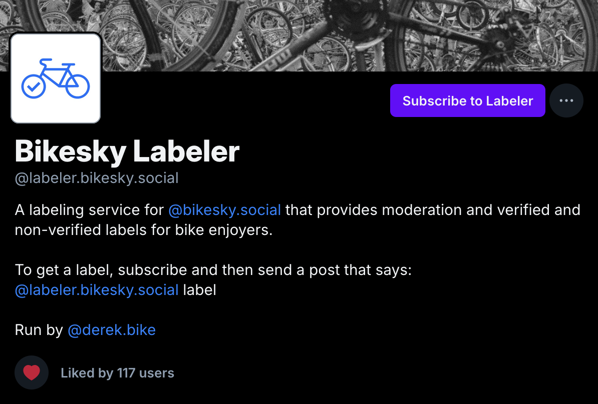
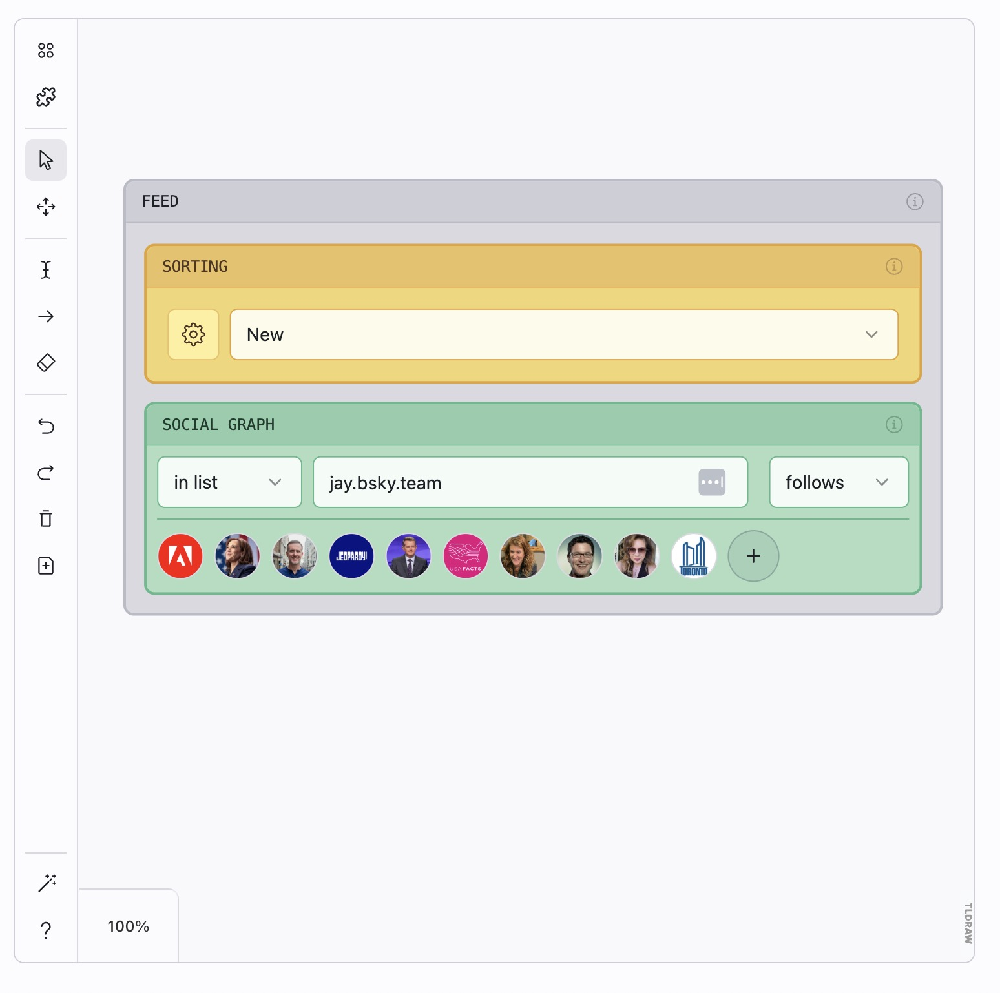
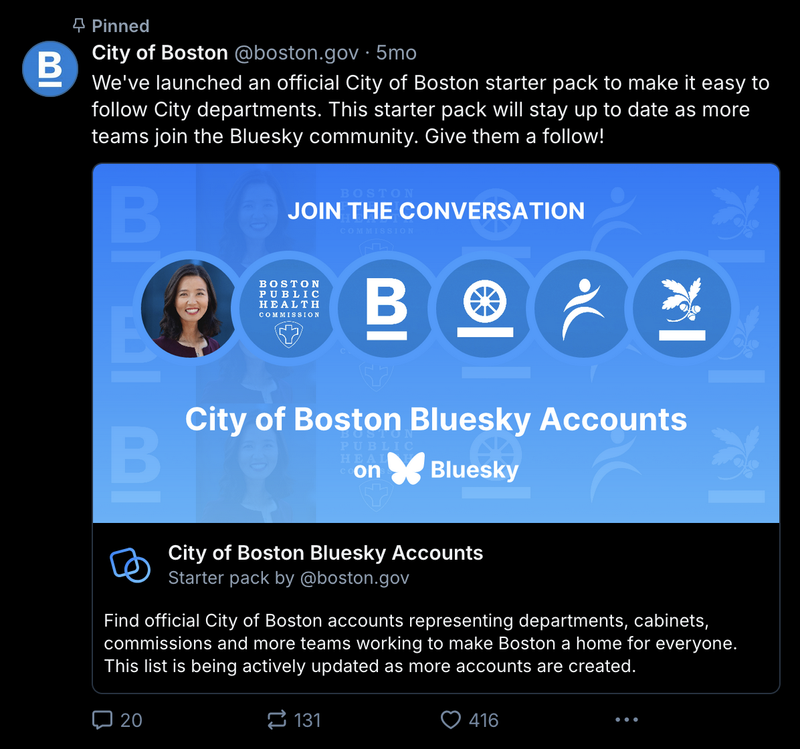
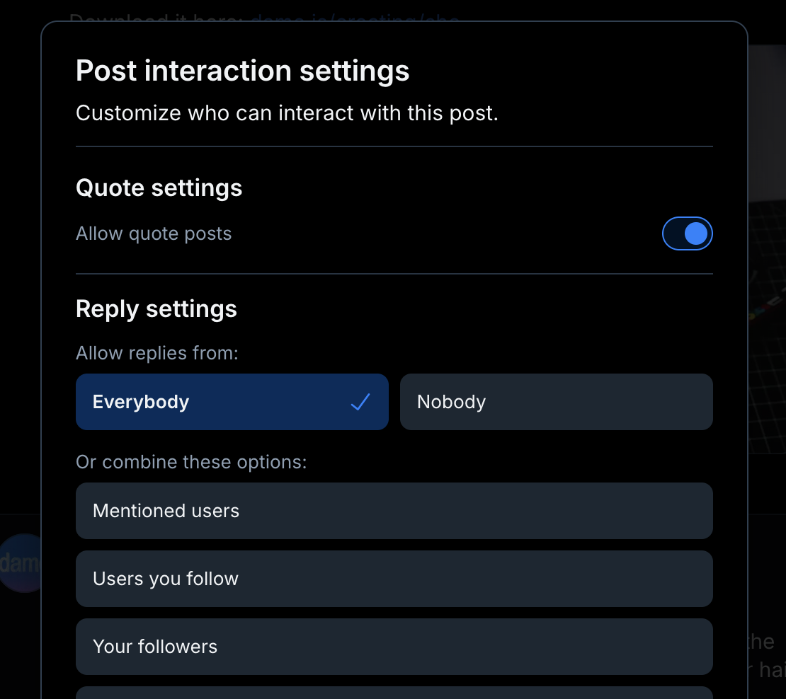

## Introduction

*Updated October 2026. I first published this guide in June 2025, and plenty has changed since then. This version adds what's new (group chats, livestream badges, longer videos, and more) and fixes the parts that had gone out of date.*

Bluesky passed [45 million registered accounts](https://bsky.app/profile/bsky.app/post/3mp54n7zccc2j) in June 2026. Daily activity is lower than it was at its late-2024 peak: according to [Jaz's public Bluesky stats](https://bsky.jazco.dev/stats), around 560,000 accounts post something on a typical day in the fall of 2026, down from about a million back then. Journalists, politicians, activists, celebrities, and everyday individuals still use it to engage with the content and communities that matter most to them. If you're wondering whether your brand should be there too, **this guide will help you decide—and show you exactly how to succeed if you do.**

Getting started on Bluesky is actually very easy, and it doesn't require a big time investment. You don't need to completely change your content strategy or brand voice to make it work. 

All it takes are a few small tweaks. You can eventually choose to dive deeper and use Bluesky's more advanced features, but they are not necessary.

But first, why should you listen to me about this? 

Well, I've been on Bluesky since basically the beginning… I was account #1,216. I also set up one of the first brand accounts, back when that wasn't something anyone thought was worth doing. 

My background is in social media and community growth, but nowadays I create resources that help people have a more enjoyable experience online. My hope is that I can use all the hours I've invested on Bluesky to make it more accessible to everyone else, including brands and communities that want to connect with their audiences there.

We'll start with the basics if you're itching to jump right in, and then proceed to covering the complexities if you're ready to take things to the next level.

Let's do this.

### The short version

If you only take ten things from this guide, make it these. Each one links to the part that explains it.

1. Use your own domain as your username, and turn on two-factor authentication. ([Quick Start](#section-2))
2. Put links right in your posts. Bluesky doesn't bury them. ([Links](#1-use-links-directly-without-any-weird-hacks))
3. Write alt text for every image and video. ([Alt text](#2-if-you-post-images-always-include-alt-text))
4. Find the custom feeds your audience reads, and learn what gets a post into them. ([Topical feeds](#4-consider-the-variables-or-conditions-of-relevant-topical-feeds))
5. Build two feeds of your own: one to track mentions of your brand, and a public one for your niche. ([Feeds](#2-feeds-easy-moderate))
6. Make a starter pack of your team or the best accounts in your field. ([Starter packs](#3-starter-packs-easy))
7. Keep an eye on what people say about you with a mentions feed, search, and activity notifications. ([Active monitoring](#active-monitoring))
8. Learn how to limit replies, detach quotes, and hide replies before you need to. ([Mitigation strategies](#mitigation-strategies))
9. Measure followers, engagement, and clicks on links tagged with UTM parameters. Bluesky doesn't show view counts. ([Measuring success](#section-5))
10. Keep a presence on other networks too, and don't make Bluesky the only place you announce anything urgent. ([Next steps](#section-7))

## Quick Start Guide

**1. Create your account.**
- Go to [bsky.app](https://bsky.app/) and click "Create account".  
- Choose an initial default username.

**2. Set up your profile.**
- Add an avatar, banner image, display name, and description.  
- Include a link to your website in your bio.

**3. Connect your custom domain.** 
- Usernames on Bluesky are just domain names. You get a default one to start, but if you want to look credible and trustworthy, you should likely use your own domain.  
- Go to [bsky.app/settings/account](https://bsky.app/settings/account) and choose "Handle".   
- Press the "I have my own domain" button.  
- Update your domain's DNS settings with the records provided. If you work at a company, you may have to get your IT department to make this change for you.  
- Wait for the DNS record changes to take effect (usually within 15 minutes, could be 24 hours).

**4. Turn on two-factor authentication.**
- Go to Settings → Privacy and security → Two-factor authentication. Once it's on, you'll need a code from your email whenever you sign in.
- If someone else will post for you, like an agency, a contractor, or a scheduling tool, create an app password for them on that same settings page instead of handing over your main password. Give each person and each tool its own app password, so you can revoke one (say, when a contractor's work wraps up) without changing the rest. Many newer tools skip passwords altogether and send you to Bluesky to approve the connection, which is even better.

**5. Make your first post.**
- Introduce yourself, announce your latest news, or share something helpful within your niche. It's probably best to wait to do this until your handle updates to your custom domain though.
- Once it's up, pin it: tap the "..." menu on the post and choose "Pin to your profile." You can only pin one post at a time, so it's a good home for your introduction or your most important link.

**6. Share about it on other channels.**
- Let your world know they can find you on Bluesky now.
- If you have a storefront, packaging, or an event booth, the share button on your profile can make a QR code that sends people straight to your account.

**7. Add your Bluesky link to your website.**
- If you have icons or links to your social media profiles on your website, add Bluesky to that list.
- Some people read Bluesky through other apps, like Blacksky or deer.social. If you want your link to work for them too, you can use a universal link from [Aturi](https://aturi.to/links) (a free tool I made) instead, like `aturi.to/profile/yourbrand.com`. Visitors see a preview of your profile and choose which app opens it.

Now, while you wait for your custom domain to finish connecting or your IT department to make the necessary configurations, let's learn more about what makes Bluesky tick.

## Understanding Bluesky

### Backstory

In 2019, the CEO of Twitter announced an internal research project called "Bluesky". The goal was to explore the feasibility of creating a decentralized internet protocol that could power Twitter and other social media platforms. 

After a couple of years and an initial funding pool of $13 million contributed by Twitter, Bluesky became an independent organization with zero ties to its originator. In February 2023, Bluesky launched its new social media app as an invite-only beta, and it opened to the public a year later in February 2024. The app was very similar to Twitter, but it was powered by what became known as the AT Protocol.

Dorsey left Bluesky's board in May 2024. Jay Graber, who had led Bluesky as CEO since it became an independent company, moved into a new role as Chief Innovation Officer in March 2026. Toni Schneider, the former CEO of Automattic (the company behind WordPress.com), took over and was named permanent CEO that July.

### The AT Protocol

While you might be tempted to gloss over the decentralized technology that underlies Bluesky, learning the basics of it can be extremely helpful in both understanding part of the Bluesky culture and also tapping into the unique opportunities it can provide.

On a traditional social media site like Twitter or Facebook, all of the user data is controlled by one centralized entity — a for-profit corporation — and stored within that entity's database in a proprietary data format that will only work with their app. 

If that social media app goes rogue, declines in quality, or gets bought by a billionaire, then the users don't have much of a choice in the matter... they either have to forfeit all of the followers and content they amassed over a long period of time or continue using the platform despite all of its toxicity and general crappiness.

The AT Protocol was built to solve this problem, and within a short period of time it has come a long way towards reaching its goals. You can now own your social networking data, take it with you, and hopefully avoid being locked into one specific app in the future.

You'll also hear people call the whole network of apps built on the AT Protocol "the Atmosphere." Bluesky is the biggest app in it, but there are plenty of others: [Flashes](https://bsky.app/profile/flashes.blue) for photos, [Skylight](https://bsky.app/profile/skylight.social) for short videos, [Leaflet](https://leaflet.pub) for blogging, [Smoke Signal](https://smokesignal.events) for events, and even [Tangled](https://tangled.org) for hosting code. Because they all run on the same protocol, you can sign into them with the same account you use for Bluesky.

### Where your data is stored

When you create an account on Bluesky, you're actually creating an AT Protocol account, even if you don't realize it. When you make a post on Bluesky, reply to another user, or like an image, all of that data gets stored in what's called your account's Personal Data Server (PDS). 

The PDS is basically just a file folder containing lots of different files that get stored on a server in the cloud. You can decide which company (or even yourself) "hosts" your data, similar to how a website is hosted.

If you're curious what's in your own folder, you can look. Paste your handle into [Aturi's explorer](https://aturi.to/explore) and you'll see every record your account holds: your posts, likes, follows, and lists, plus anything you've made in other Atmosphere apps. 

By default, new Bluesky accounts have their PDS data hosted on one of many different Bluesky servers, each of which is named after a different type of mushroom.

`shiitake.us-east.host.bsky.network`  
`oyster.us-east.host.bsky.network`  
`maitake.us-west.host.bsky.network`

If Bluesky were to ever shut down or become hostile, users could move their data to a new host and still maintain all of their likes, followers, and posts.

Think of it like your email provider — there are many different companies that provide email hosting services such as Gmail, Outlook, and iCloud. If you ever need or want to, you can download your email archive and contacts and import that data into another email provider. 

The reason this is possible is because all of these companies chose to build their product on top of the decentralized protocols that emailing technology uses. In that sense, the AT Protocol is sort of like email but for social media.

And this isn't just a theory anymore. A handful of independent organizations now host accounts, including [Blacksky](https://blacksky.community), [Eurosky](https://eurosky.tech) in Europe, [Northsky](https://northsky.app) in Canada, and [Aster ID](https://aster.place), a nonprofit host for researchers. In June 2026, the European Commission moved its account (@ec.europa.eu) off of Bluesky's servers and onto a European service called W Social, and it kept its handle and its followers. Even the account that publishes this guide, @atpota.to, lives on its own server instead of one of Bluesky's mushrooms.

Moving still takes some effort. There's no "move my account" button in the Bluesky app, so you would use a migration tool from your new host (Blacksky and Eurosky both offer one). But the option is real, which means Bluesky has to keep earning your business like any other host.

### How Bluesky is different from Twitter

Many people think Bluesky is just a decentralized version of Twitter. And while that's true in some ways, Bluesky has many features that Twitter (now X) never had and likely never will have. Let's walk through each of these features and then revisit some of them later to discuss how to use them effectively.

#### 1. Custom feeds (algorithms)

Perhaps its flagship feature, Bluesky has become famous for how it allows anyone to not only choose which algorithm their feed uses, but also build their own. Gone are the days of being forced to scroll through a non-chronological feed containing posts from random accounts you've never followed. For creators and brands, this means that your primary goal is no longer just "appease the algorithm"… because there isn't just one singular algorithm to please.

Bluesky comes with a few optional feeds out of the box. The two main ones are 1) Discover, and 2) Following. (New accounts also get a Video feed.) 

Discover is Bluesky's proprietary suggestion algorithm similar to TikTok's "For You" feed. The difference of course is that no one has to use the Discover feed or even have it appear in their app at all… you can disable it completely and rely upon the Following feed, another community-made feed, or a custom feed of your own design.

It works in the other direction too. Since August 2026, people can opt out of having their posts shown to non-followers in Discover, for the times when they'd rather just talk to the people who already follow them.

#### 2. Third-party moderation services

After the AT Protocol launched, there was a lot of talk about the concept of "composable moderation", which basically just means a suite of tools and infrastructure that would let anyone provide moderation services on top of the network. 

One of the most well known examples of this is [Blacksky](https://bsky.app/profile/blackskyweb.xyz), which provides a space for Black community building. Users can subscribe to [Blacksky's moderation service](https://bsky.app/profile/moderation.blacksky.app), report posts/content to it, and filter content out of their feeds based on it instead of (or alongside) Bluesky's official moderation. Blacksky has grown a lot since it started, too. It now runs its own app at [blacksky.community](https://blacksky.community), hosts accounts on its own servers, and offers a tool for moving your account over.

There's even [a moderation service that automatically detects and flags posts that contain screenshots](https://bsky.app/profile/xblock.aendra.dev) from other prominent social networks like X, allowing users to hide this content from their feeds completely. So, cross-posting by using screenshots might not be the wisest idea.

Bluesky also has "moderation lists" that any user can create and subscribe to. On a basic level, these are just lists of accounts, but you can use them to automatically block or mute accounts in bulk with one tap. For instance, there are a series of [semi-popular moderation lists](https://bsky.app/profile/automated-lists.bsky.social) for blocking or muting all accounts that follow more than a certain number of accounts (10,000+, 50,000+, etc). Lists like these allow people to keep follower farmers away from them before they even have a chance.

#### 3. Labelers + content filters

Connected to third-party moderation services are a special tool called "labelers". What is a labeler? Well, it applies labels to things. 

There are moderation labelers that allow you to hide, warn, or filter posts/accounts based on specific labels (i.e. like the screenshot labeler mentioned earlier), but then there are also vanity labelers that allow users to self-identify with communities, causes, and more by applying a voluntary public label to their own account. 

For instance, there used to be a vanity labeler for Swifties that let them add a little "flair" to their profile in the form of their favorite Taylor Swift Era. (It's no longer around, which is a lesson we'll come back to later.) Custom labelers of all types and sizes can be created by anyone, though the process to do so is still quite technical at this time.

#### 4. Domain names as usernames

Ever been frustrated when joining a new app and learning that your username of choice has already been taken? On Bluesky, this problem is not nearly as significant thanks to the fact that all usernames on the network are actually domain names. 

When you create a new account, you can get a default username that looks like `name.bsky.social`, but you can (and should) set up your own because brands and creators without default names are sometimes seen as potential impersonators. 

Using your own domain name is a way to self-verify your account's legitimacy. For instance, NPR (National Public Radio) has the username of @npr.org, which is also its official website. Only the owner of the domain can possibly set it as a Bluesky username, so you know with confidence that the account is official. There are even many government accounts that can be quickly identified by their country's government domain structure (such as .gov in the United States).

You can also set up subdomains as usernames, so you could set up team member accounts such as name.brand.team. Bluesky itself does this for many of its employees. The CEO, Toni Schneider, is @toni.bsky.team, and the founder, Jay Graber, is @jay.bsky.team.

[How to use your domain as your Bluesky handle](https://bsky.social/about/blog/4-28-2023-domain-handle-tutorial) 

#### 5. Trusted Verifiers

In addition to being able to self-verify your account via your domain name, there is also a unique verification system run by Bluesky that functions similarly to the original "blue check" from Twitter before it became X. While it may look the same on the surface though, there's actually a lot more going on.

Bluesky can issue blue check verifications like you would expect, but it also can designate a third-party organization like the New York Times to be considered a "Trusted Verifier", meaning that there are now multiple independent sources for verification. When the program launched in April 2025, there were only a handful of "Trusted Verifiers". By the end of that year, according to [Bluesky's 2025 transparency report](https://bsky.social/about/blog/01-29-2026-transparency-report-2025), there were 21, including WIRED, CNN, the European Commission, and the City of Toronto, and together with Bluesky they had verified about 4,300 accounts.

Furthermore, the underlying technology that makes this system possible is completely composable, meaning that any user on the network can issue a "verification" record for any other account and theoretically become a "Trusted Verifier" themself. 

While the odds of this are relatively low in the official Bluesky app, there are already third-party Bluesky client apps like [deer.social](https://deer.social) with a setting (turned off by default) that lets you choose your own list of "Trusted Verifiers". This means that you could have blue check marks appear next to accounts verified by your friends or colleagues rather than from Bluesky or the New York Times.

If you think your brand qualifies for a blue check in the official app, the only official way to ask is the request form linked in [Bluesky's verification announcement](https://bsky.social/about/blog/04-21-2025-verification). Bluesky has said it won't contact you about verification through DMs, or ask you to move the conversation to Discord or Telegram, so treat any message like that as a scam.

One more thing to know before you ever rebrand: a verification only counts while your handle and display name match what they were when you were verified. Change either one, and the check mark goes away until you're verified again.

#### 6. Free, open API

Twitter used to have a free and relatively open stream of public data that was accessible via an API (Application Programming Interface), but when Elon Musk took over, he quickly shut this API down and started charging exorbitant prices to access the data. 

If you're unsure of what an API is or why it's significant, just compare the vibrant ecosystem of third-party integrations and applications that exists on Bluesky with what X has today... Bluesky is like a lush beautiful garden filled with lots of diverse plant life, and X is a vacant backlot with some old and dying corporate landscaping. 

An API is merely a highway that developers and creators can use to retrieve and send data. With Bluesky, that highway is open, free, and lets you explore the world. With X, only the wealthiest can drive on the highway and there are speed traps everywhere.

An open and free API means an environment friendly to innovation, network effects, and the public good.

#### 7. Everything is public

Speaking of the public, almost everything you do on Bluesky is publicly accessible data (even blocks and likes!). This won't matter that much to brands, organizations, and creators who explicitly want their content to be public, but it might matter to some of the people in your audience or community. Stay mindful about it.

A few things are private: bookmarks, drafts, mutes, and direct messages. Bluesky's DMs aren't end-to-end encrypted, though. If you need that, you can start an encrypted conversation from someone's Bluesky profile using a separate app called [Germ](https://germnetwork.com). A broader system for private data on the AT Protocol, called "Spaces," is being tested with developers as of fall 2026, and Bluesky says it should start rolling out by the end of the year. 

#### 8. In-app media players

On most social platforms, sharing a YouTube or Spotify link won't play the media directly within the app. Instead, users have to leave the platform and open YouTube or Spotify to watch or listen. On Bluesky, this isn't the case. You can listen to music or watch embedded videos without having to leave the app. 

#### 9. No outbound link suppression

Since we're on the subject of sharing links, now's a great time to mention that another defining and powerful feature of Bluesky is that its "Discover" feed algorithm doesn't suppress and down rank content that contains links to outside websites. This is huge for companies, brands, and creators because you no longer need to perform silly algorithmic gymnastics just to get followers onto your website. Bluesky has [said so directly](https://bsky.app/profile/bsky.app/post/3lv76v3dauk2w): "there's no limit to the number of links you can share, and they will receive the same visibility as your other posts."

#### 10. Starter packs

One of the difficult parts of joining a new social network is finding accounts that share your common interests and values. Bluesky tackled this issue with a feature called Starter Packs, and within six months, [Meta's Threads app was testing its own version](https://www.engadget.com/social-media/threads-take-on-bluesky-starter-packs-is-live-193106158.html). 

At their core, Starter Packs are hand-curated lists of accounts that anyone can make. Each starter pack even has an invite-link attached to it. By sharing a Starter Pack with someone, they can create a new Bluesky account and follow a bunch of relevant accounts instantly. 

This feature works especially well for community building, whether that's for a city (Boston!), a fandom (kpop!), or even bicycle riders. If you're a brand, you could set up a Starter Pack that has your entire team in it or trusted industry voices.

#### 11. Advanced preferences

Hidden under the surface of Bluesky are a plethora of user customizations that apply to the "Following" feed (the reverse-chronological feed of just posts from accounts someone follows) and beyond. For instance, you can disable seeing reposts, quote posts, and replies. You can even hide the reposts from one specific account you follow while still seeing its original posts. 

Within threads, you can sort the replies by top, oldest, or newest, and switch to a tree view that shows exactly who is replying to whom. Replies from people you follow get bumped up automatically. (There used to be a random option nicknamed "Poster's Roulette," but it was retired in 2025.) 

#### 12. Advanced reply/quote settings

Not only can you turn off replies to your Bluesky posts, but you can also customize reply permissions in extremely granular ways. For instance, you can specify that only users on a custom list can contribute to the conversation or make it so that someone has to be following you in order to reply. 

Additionally, you can prevent people from quote-posting your content completely. Both of these features are even available to apply retroactively. Since late 2025, you can also save your preferred settings as the default for every new post.

And if someone quotes your post in a way you don't like, you can detach your post from their quote, so it no longer shows up inside it.

#### 13. Nuclear block

Bluesky has intentionally tried to cultivate an environment where users have more control over who can interact with them. One of the ways they achieved this is through what is colloquially known as the Nuclear Block. 

If two people are having a conversation on Bluesky and one blocks the other, the entire conversation thread becomes hidden from view for everyone else. This feature is a bit controversial, having divided the community into two camps: people who love it and people who hate it. There's not much that can be done about it though, so just keep it in mind if you ever see a "blocked" message in a thread and wonder what's going on. It doesn't always mean that you've been blocked by someone.

#### 14. Paragraph breaks in bios

Lastly, it's a small detail, but Bluesky profiles offer flexible bio formatting, making it easy to create a clean, readable description without needing tedious tricks or workarounds. There is no dedicated field for links, but you can add as many as the character limit will allow.

### Audience and Culture

Over the course of Bluesky's history, its culture has shifted as the network has become more populated. When there were only several thousand users, the space reflected the industry it sprang out of, so it was very centered on the United States' technology scene.

Eventually, there were growth periods that were dominated by other countries such as Japan or Brazil, with the latter case happening due to X temporarily abandoning Brazilian users entirely.

The biggest growth event that the network has experienced so far though was in the days surrounding the 2024 United States presidential election, at which point millions of people created new Bluesky accounts in an effort to migrate off of big tech social networks like Facebook, Instagram, and X.

Growth has slowed since that rush. Sign-ups kept coming (Bluesky went from about 26 million accounts at the start of 2025 to about 41 million at the end of it, according to its [transparency report](https://bsky.social/about/blog/01-29-2026-transparency-report-2025)), but as I mentioned at the start of this guide, fewer people post on a typical day now than they did back then.

In the months after the election, many people mistakenly started to assume that Bluesky had effectively become a politically left-leaning platform just for democrats. In reality, the culture of Bluesky is so multi-faceted at this point that it really doesn't make sense to think about it with such a hegemonic lens.

There isn't a singular "Bluesky Culture" anymore. The user base is made up of millions of people from all over the world with an innumerable number of niche interests. Some of those communities have gotten big. Sports is a good example: Bluesky said activity on the network jumped 70% during the 2026 Super Bowl. Japan's community is big enough that Bluesky launched an official Japanese-language account in April 2026.

Start thinking about Bluesky as a diverse system of hundreds (if not thousands) of large to small sub-cultures. Approaching the network with this perspective will better prepare you for all the different types of people you likely will encounter on any given day, and it will help you find the communities you are most interested in.

### Why people use Bluesky

While it's true that Bluesky is hard to pin-down culturally, there are a variety of big ideas that tend to attract people to it and influence it on a monocultural level. Keeping these themes in mind might help you avoid some faux pas.

#### 1. It's an open, decentralized, interoperable network.

For the past two decades, most people have only experienced an online social network that is both centralized and closed. Platforms like Facebook, TikTok, and X became known for trying to keep people on their apps for as long as possible to make money from advertisements, even if it meant making the user experience worse by pushing invasive algorithms and hiding links to outside websites.

As the years went on and the user experience continued to degrade, more and more people started to be fed up. A new future began to be conceived of, and experimental versions of alternative social apps started to gain some traction. The properties that defined these platforms were usually one or all of the following:

##### A. Open

A significant portion of the network's data is publicly accessible via open APIs and storage. Additionally, anyone can create and host their own account.

##### B. Decentralized

The network is designed and implemented in such a way that one centralized entity can't own or control everything within it. Decentralization exists on a spectrum, but in general a decentralized social network will be accessible from many different apps called "clients" and the data on the network is somewhat distributed across many different "nodes" or "hosts".

##### C. Interoperable

An "interoperable" network means that the data and features that exist in one place can be easily used in many different places. A simple example of this would be multiple different apps that rely on the same user profile data. For instance, you would login to a new app, and it could recognize your existing profile data that you made on Bluesky.

#### 2. There aren't any ads… yet.

One of the primary reasons traditional corporations implement user-hostile things like link suppression and intrusive algorithms is to maintain their revenue model: advertising. Their primary incentive is to keep users in their apps for as long as possible at all costs.

With Bluesky, a traditional advertising model is not nearly as feasible or sustainable due to the underlying protocol's design and open nature. If Bluesky began having advertisements in their app, people could easily choose to consume the same content through the "window" of a third-party app that doesn't have ads.

In this situation, the primary way to keep people using your app (and even get them to pay for it!) is to offer an unparalleled positive experience with quality features. This framework better aligns the company's incentives to be in step with the users' needs. 

This isn't to say that advertising will never exist within Bluesky, but at the very least it won't manifest in the exact same way as it has in the past.

As of October 2026, the Bluesky app still doesn't show ads. Bluesky's leadership [has said](https://techcrunch.com/2026/10/15/bluesky-wants-to-make-it-easier-to-buy-sell-and-fundraise-on-the-network/) the company plans to start making money with payments instead, so people can support, buy from, and fundraise for each other right on the network. There is one kind of advertising here already, and it shows the different shape ads can take on an open network: [Graze](https://graze.social), a popular tool for building custom feeds, lets brands sponsor posts inside community feeds, and the person who runs each feed picks which sponsors to accept and keeps most of the money. More on that later.

#### 3. There's more control.

One of the many benefits of an open and interoperable network is that users have greater control over their individual experiences. Bluesky empowers users with a significantly higher degree of agency in comparison to traditional social platforms. 

This reality also contributes to Bluesky's multicultural environment... for any given user that you meet, you can't assume that they are engaging with the network using the same "lens" that you are.

#### 4. It's not "big tech".

Given the fact that almost all of the major social media platforms in the United States have decided to align themselves with specific government administrations and policy proposals, even to extreme degrees, many people are uncomfortable spending their time with products made by those companies. Bluesky does not have the same affiliations or baggage, thus making it an attractive alternative. It is still a venture-backed company, though: in 2026, Bluesky [disclosed](https://bsky.social/about/blog/03-19-2026-series-b) that it had raised $100 million the year before. The open protocol is the safety net here. If Bluesky ever changed course, people could take their accounts and followers somewhere else.

Now that you have a solid understanding of Bluesky, its underlying technology, and its multifaceted community, you're ready to start thinking about how you can practically fit into the equation.

## Achieving Growth and Engagement

If you're reading this guide, then you're probably not on Bluesky just to have fun and blow off steam. You're likely an organization or a public figure that has a product, service, or cause that you need to promote to achieve your goals. In order to do that, you need to get people's attention and sustain their interest in what you have to say. **Thus, you need followers and engagement.**

Attracting followers wasn't easy on traditional social media, so it's not easy on a decentralized network like Bluesky either. Plus, Bluesky doesn't sell ads, so you can't reliably use "paid media" to force your way into people's attention spans.

Instead, you have to provide valuable content that gets spread organically. This guide won't be teaching you how to do that, but it will be showing you how to apply that content creation to the unique context of Bluesky in a way that maximizes its potential.

### Formatting and packaging your content for Bluesky

#### 1. Use links directly, without any weird hacks

As we've discussed in previous sections, Bluesky does not suppress outbound links to other websites. This means that you don't need to perform the same algorithmic gymnastics just to sneak in a link to your website. Instead of making a main post and then following up with a reply containing the link or pointing to your bio, just put the link in the main post. 

If you were to keep using the workarounds that are required on other platforms, many Bluesky users might see your activity as half-hearted, ignorant, or even cringe. On Bluesky, people like links and don't want to have to go searching for them in weird places.

❌ Don't: 'Great article! (link in bio)' 

✅ Do: 'Great article on sustainable fashion: [direct link]'

#### 2. If you post images, always include alt text

More so than in other places, a significant part of Bluesky's culture cares a lot about web accessibility. By including alt text on your images, you're being inclusive to people with certain disabilities, but you're also making your content more discoverable because alt text is included in search results!

For instance, if you post a screenshot of a document or promotional graphic, you should include all of that content as alt text too. If you didn't do this, then your post would not end up in relevant search results where it otherwise could and should. There are even Bluesky users who refuse to share content from other accounts if alt text isn't present. The same goes for videos, which can have alt text too.

❌ Don't: 'event poster'

✅ Do: 'Poster for our Spring Market: Saturday, May 9, 10am to 4pm at Lowell Park. Free entry, 40 local vendors, and live music.'

#### 3. Be conservative and mindful with your hashtag usage

While hashtags are supported on Bluesky and used in many different contexts, including them in all of your posts can be seen as a desperate attempt for attention and a form of engagement hacking in many spheres. Depending on your industry and context though, the usage of hashtags might be more normal and prevalent. It's wise to take a look at what other accounts in your community/niche are doing to see what is and isn't common practice.

If you're a public company or you talk about markets, Bluesky also supports cashtags like $AAPL, which work the same way as hashtags.

#### 4. Consider the variables or conditions of relevant topical feeds

Remember, Bluesky doesn't just have one algorithmic feed. It has a limitless number of customizable user-generated algorithms in addition to its default "Discover" algorithm. Many people disable the default algorithm completely and choose to rely upon more niche or topical feeds instead. 

For instance, there are community-controlled feeds dedicated to lovers of mushrooms/fungi, web development, and academic research. Each of these feeds has a custom algorithm with different conditions/rules that dictates which posts or content show up in the feed (this is often a good use-case for hashtags). Consider if there are any popular feeds in your niche that would welcome your contributions. If you do find such feeds, try to see if there is any public documentation available that shows how the feed works, and then use that information appropriately while crafting your related content.

Be warned though, if your activity violates the norms or rules of a custom feed, your entire account could get banned from ever appearing in it again. Don't be a bad actor.

#### 5. There is no edit button, so spell-check your content carefully

Most social platforms these days allow for editing a post if you make a typo or need to add something after the fact. Bluesky still doesn't support this feature. In May 2026, Bluesky's head of product [said](https://bsky.app/profile/alexbenzer.com/post/3mlvrfzti7k25) the team was discussing a limited version (one edit, within five minutes, text only, with the earlier version visible to everyone), so even if it ships, it won't save you from much. While it is technically possible to edit posts under the hood on the protocol level, doing so is a bit technical, requires third-party tools, and usually is not advisable (it also will reset the post's engagement stats).

One thing that does help: since February 2026, Bluesky has drafts, so you can write a post, step away, and come back to proofread it before it goes out.

#### 6. You can embed videos and audio from some third-party services directly in a post

While it doesn't make sense to post a YouTube link on Twitter/X anymore because of suppression, Bluesky embraces offsite media content and allows users to watch/listen without ever leaving the app. As of October 2026, the following services are supported: YouTube, Vimeo, Twitch, Spotify, Apple Music, SoundCloud, Bandcamp, Flickr, FreeMix, and the GIF services GIPHY, Tenor, and KLIPY.

#### 7. Post more photos and longer videos

Bluesky has raised its media limits several times since this guide first came out. A single post can now hold up to 10 photos (posts with five or more show up as a swipeable carousel), and each photo can be up to 2MB and 4000×4000 pixels. Videos can be up to 10 minutes long and 300MB, up from three minutes when I first wrote this guide. If you were trimming videos down just for Bluesky, you can stop.

#### 8. Let Bluesky number your threads

If you write threads, you don't have to number the posts yourself anymore. Since September 2026, Bluesky numbers the posts in a thread automatically, and the numbers stay attached even when someone quotes one of them. Typing "1/" at the start of each post now just doubles up.

#### 9. Link to your long-form writing

Bluesky posts still top out at 300 characters, so long-form writing lives somewhere else. What's new is how well it shows up here. Blogging platforms built on the AT Protocol, like [Leaflet](https://leaflet.pub), [pckt](https://pckt.blog), and [Offprint](https://offprint.app), publish articles using a shared format called [Standard.site](https://standard.site), and since May 2026, links to those articles appear on Bluesky as richer preview cards. Because the articles are stored in your own account's data, they also come with you if you ever change hosts. If your brand has a blog or newsletter, this is worth a look. (This guide is published the same way, and you can [see its record on Aturi](https://aturi.to/profile/did:plc:qntsxa2i4sb24noi45fx4np2/site.standard.document/3lrdzen52y224).)

#### 10. Check how your links will look

When you add a link to a post, Bluesky builds a preview card from your page's Open Graph tags: its title, description, and preview image. If your website doesn't set those tags, your links show up as bare cards with no image, which are easy to scroll past. Before you launch, paste a few of your links into the post composer and see what comes up. You don't have to post them. Get this right early, because the card is saved when you post. Fixing your tags later won't change the cards on posts that are already up.

### Leveraging Bluesky's unique features for growth and engagement

#### 1. Labelers (Advanced/Expert)

A Labeler is a customizable integration that can be used to display helpful information within the Bluesky app. They are used to apply textual and visual labels to either specific accounts or specific posts. These labels are only visible to users who "Subscribe" to the Labeler, meaning users must explicitly opt-in for the tags to appear in the user interface of their app.

While Labelers were originally designed as a "serious" moderation tool, they have now evolved to include even more casual or even silly use cases. For instance, the official Bluesky company released a Super Bowl Labeler for the 2025 Super Bowl which allowed users to apply a label to their accounts to display which football team they were rooting for.

Other Labelers use more advanced technology to automatically analyze and categorize accounts/posts based on publicly available data. 

Let's say you are a video game studio with a beloved game that has many different playable characters. You could create a Labeler that would allow your community members to tag their profile with their preferred character's name. Or, maybe you are a coffee shop chain and want to create a Labeler that would allow people to display their favorite drink order.

Here is a list of some different Labelers to give you more inspiration and ideas:

* [Bikesky Labeler](https://bsky.app/profile/labeler.bikesky.social)  
* [2025 Super Bowl Labeler](https://bsky.app/profile/did:plc:h2btirb6mgshvzf2jqrsggbc)  
* [Northsky Pronouns Labeler](https://bsky.app/profile/pronouns.northsky.social)  
* [The Cave of Trophonius](https://bsky.app/profile/oracle.posters.rip)  
* [Screenshots Labeler](https://bsky.app/profile/xblock.aendra.dev)

Creating your own Labeler is not user-friendly at the moment though, but it is possible if you have some coding/development skills. To get you started [check out this Github Repository](https://github.com/aliceisjustplaying/labeler-starter-kit-bsky) that a community member created to serve as a starter kit for creating a Labeler.

If you do build one, plan on keeping it running. Labels only exist for as long as the labeler behind them stays online, so when one shuts down, every label your community picked goes with it. That's what happened to the pronouns labeler I originally recommended in this guide, and to the Swifties labeler mentioned earlier. These days I'd point people to [Northsky's pronouns labeler](https://bsky.app/profile/pronouns.northsky.social), which is run by Northsky, the Canadian account host mentioned earlier, rather than by a single person. You can pick your pronouns by liking one of its posts or on [its website](https://pronouns.northsky.app/).

#### 2. Feeds (Easy/Moderate)

One of the most popular, powerful, and relatively easy things you can do is create a custom feed using the no-code tool [graze.social](https://graze.social). In fact, I would recommend creating at least two different feeds: 1) an internal feed you use for actively listening for mentions of your brand, product, or cause, and 2) a public community feed that ties in with your niche in some way.

The internal feed is designed to include only mentions of your brand name, links to your website, or important keywords for monitoring trends. You, your social media manager, or customer support team can use this feed to stay on top of feedback or community questions. Keep in mind though that any feed you create is public and could be followed by any other user.

The public feed is your brand's contribution to the community. It should be a highly valuable feed that displays curated or relevant posts from other accounts that are about or adjacent to your niche. This feed shouldn't be specifically for just the people that are aware of you, but rather it should be for appealing to newcomers first and foremost. 

By doing this, you're providing a valuable free service to people and getting your brand name out there at the same time. Be tactful in how you promote yourself though using this method, most people are not going to be interested in a feed that is created or managed in a way that comes across as self promo or advertising.

For a recent example, The A.V. Club (@avclub.com) ran an "Emmys Watch" feed during the September 2026 Emmys and asked its followers to pin it, and Bluesky's official account shared it.

Whatever you build, give it a description that says what's in it and how people can get their posts included:

❌ Don't: 'Our feed'

✅ Do: 'Sourdough and wild yeast baking posts from across Bluesky. Add #Breadsky to your post to be included.'

A few things have changed with Graze since this guide first came out. In August 2026, it was [bought by Flipboard](https://techcrunch.com/2026/08/26/flipboard-acquires-graze-the-feed-builder-working-to-monetize-the-open-social-web/), which plans to bring Graze's feed tools to other apps on the AT Protocol, including Flipboard's own. Building a feed is still free. Graze is also where Bluesky's version of advertising lives: brands can sponsor posts that appear inside feeds, the person who runs each feed decides which sponsors to accept, and they keep 70% of the money. If there's a popular feed in your niche, sponsoring it is one of the only paid options on the network, and the money goes to someone who's already serving your audience.

Graze isn't the only way to build a feed, either. [SkyFeed](https://skyfeed.app) and [Bluesky Feed Creator](https://blueskyfeedcreator.com) are other no-code tools (Boston's and many of Bikesky's feeds are built with SkyFeed), and Bluesky has its own app called [Attie](https://attie.ai) that builds a feed from a plain-language description of what you want to see. Attie uses AI to do this, so keep in mind what we'll cover later about how some parts of Bluesky feel about AI.

#### 3. Starter packs (Easy)

As a reminder, Starter Packs are just curated lists of Bluesky accounts that you're recommending other folks check out or follow. They are helpful for sending to new community members or onboarding people to Bluesky itself. When you send a Starter Pack link to someone, they can easily follow all of the accounts contained within it and create their very own Bluesky account using the pack's special invite link.

When thinking about creating your own Starter Packs, one simple option would be to create a Starter Pack with prominent public-facing members of your organization or team that you want people to also follow.

Another idea would be to curate a list of adjacent brands and content creators within your niche. For instance, if you are a fashion designer, then you could put together a list of other prominent designers and clothing labels within your industry. There's a chance your Starter Pack might be well-received and get spread around a lot, thereby earning you some attention for it.

You can even include up to three custom feeds in a Starter Pack, so people can use them to find the feeds you created earlier as well.

Starter Packs are easier to discover now, too. Since September 2026, they show up in Bluesky's main search under their own tab, so give yours a name and description that make it obvious who it's for. You can also add someone to one of your packs straight from the menu on their profile.

#### 4. Custom domains / handles (Moderate)

While the primary purpose of domain names as usernames on Bluesky is for self-verification purposes, people have begun using subdomains for community identification and recognition. A subdomain is when you see a normal domain like example.com but it has an extra part tacked on at the beginning such as extra.example.com, with the "extra" part being the subdomain. This can be powerful when you pair it with a tool like [handles.net](https://handles.net/) which allows you to give custom subdomains to your community members, volunteers, or team members.

For instance, Taylor Swift fans can get their very own free username that uses the swifties.social domain, making it easy for other Swifties to identify them as part of the group. So your username could be @hannah.swifties.social. The Bluesky team itself uses this for some of their team members, such as @toni.bsky.team. If you only want to issue a handful of subdomain handles, then you can do this fairly easily within your domain manager's DNS settings, but if you intend to issue a large number of usernames then it's best to get your IT team to assist or use a service like [handles.net](https://handles.net/).

#### 5. Group chats (Easy)

In June 2026, Bluesky added group chats, which it described as its ["first feature built for communities."](https://bsky.app/profile/bsky.app/post/3mnzmprxpe22y) A group chat can hold up to 100 people, and you can share an invite link instead of adding everyone by hand.

For a brand, a group chat works best as a smaller, more personal space alongside your public account: a group for your most engaged customers, beta testers, volunteers, or local organizers. A few limits to keep in mind:

- Group chats aren't end-to-end encrypted, so don't use them for anything sensitive.
- They're text only for now. You can share links and quote posts, but not images or videos.
- People under 18 can't use them, and Bluesky treats accounts with no birthdate on file the same way.
- By default, people only accept group invites from accounts they follow. An invite link gets around that: whoever created the group can make one that lets people join instantly or ask to join, and share it in a post.
- Brand-new accounts can't create groups, so set yours up ahead of time.

#### 6. Live Now badges (Easy)

If you livestream, you can link your stream to your Bluesky profile while you're live. On your profile, tap the "..." button, choose "Go live," paste your stream link, and pick how long the badge should show (up to four hours). Your avatar gets a red ring and a LIVE badge, and people can tap it to go straight to your stream. It works with Twitch, YouTube, Substack, beehiiv, Streamplace, and Bluecast, and it has been open to everyone (as a beta) since January 2026. If your brand does live events, product demos, or behind-the-scenes streams, it lets people on Bluesky know you're on without you having to post about it over and over.

#### 7. Direct messages (Easy)

By default, Bluesky only lets people you follow send you a direct message. That's a sensible setting for individuals, but a brand that wants customers to be able to reach it should change it: open the chat tab, go to Chat settings, and set "Allow direct messages from" to "Everyone." If you'd rather not handle support in DMs, leave it alone and say in your bio where people should go instead. Either way, remember that Bluesky DMs aren't end-to-end encrypted, so never ask anyone to send passwords, payment details, or other sensitive information there.

#### 8. Automated account labels (Easy)

If your brand runs an account that posts automatically, like service alerts, new blog posts, or product updates, mark it as automated in your account settings. Bluesky added this option in March 2026, and it puts a label on the profile and its posts so people know they're not talking to a person. BART, the San Francisco Bay Area's transit system, keeps the two separate: @bart.gov is its main account, and @alerts.bart.gov handles the automated alerts.

### Case Studies

#### The City of Boston

[https://bsky.app/profile/boston.gov](https://bsky.app/profile/boston.gov)

The most populous city in the commonwealth of Massachusetts is also one of the most active municipalities on Bluesky currently. Boasting more than three dozen interconnected government-owned accounts, Boston's embrace of Bluesky is a great blueprint for how a large entity could join the social network. 

Each of their major city departments has its own Bluesky account with consistent branding and official usernames that are self-verified using the subdomain system. Anyone can instantly recognize a Boston account as being official because they all end in the [boston.gov](https://boston.gov) domain name. The city even gives its neighborhood liaisons their own accounts, like @roxbury.boston.gov, so residents can find the person who covers their part of town. Furthermore, they have a Starter Pack that contains all of the city accounts, plus the mayor, in one place so that Boston residents can quickly follow all of these local sources with one tap.

Boston even has a unified custom feed that you can follow to see just city updates across all departments in one timeline, clutter free.

#### Bikesky

[https://bsky.app/profile/bikesky.social](https://bsky.app/profile/bikesky.social)

A bicycle rider named Derek van Vliet took it upon himself to organize a community on Bluesky for bike enthusiasts. He called it "Bikesky", and it now has over 14,000 followers. It also supports almost every single one of Bluesky's unique features such as custom feeds, labelers, starter packs, and even a moderation service. 

The Bikesky labeler lets a community member add a tag to their profile to display what kind of bike enthusiast they are. These labels range from "Tandem Bike Partner", "Recumbent Rider", to even "Folding Bike Fan". This tool makes it easy for community members to recognize and connect with one another, especially those that share common interests or traits.

Bikesky now runs about 30 custom feeds so that bike enjoyers can find niche content created within the biking community, including city feeds like #BikeTO and #SFBike. Many of these feeds gather/curate posts automatically by matching the #Bikesky hashtag.

#### Bandcamp

[https://blog.bandcamp.com/2025/03/17/now-introducing-our-integration-with-bluesky/](https://blog.bandcamp.com/2025/03/17/now-introducing-our-integration-with-bluesky/)

The popular online music platform for independent recording artists known as Bandcamp launched a first-of-its-kind integration with Bluesky in March 2025 that allows its Pro users to set their Bluesky username to be their Bandcamp subdomain such as `artist.bandcamp.com`. It's unclear how many of its users have adopted the feature yet, but either way it serves as a powerful example of how another platform can choose to connect to Bluesky and let its community self-identify in a way that makes sense to them. The relationship has gone both ways since then: in February 2026, Bluesky added Bandcamp embeds, so songs and albums now play right inside Bluesky posts.

## Analyzing and Measuring success

Once you've started posting on Bluesky, there might come a time where you need to see if what you're doing is having any effect. How you go about investigating this will largely depend on your specific goals and needs, but in general here are some of the key areas you can pay attention to:

- Follower count  
- Engagements received (likes, reposts, replies, mentions)  
- Engagement rate  
- Website traffic from Bluesky

For website traffic, don't count on your analytics tool to recognize every visit from Bluesky. Visits from mobile apps often arrive without any referrer information, so they get lumped in with "direct" traffic. Adding UTM tags to the links you post (for example, `?utm_source=bluesky&utm_medium=social`) makes those visits show up properly in tools like Google Analytics or Plausible.

Unlike other major social media platforms, Bluesky still doesn't offer in-app analytics or social media management features that you might be accustomed to (as of October 2026). Thanks to its free and public API though, dozens of third-party social media management tools have popped up that can help fill the gap.

While most of these tools are free for anyone to use, they vary widely in terms of the quality and set of features they provide. The right combination of tools for you will depend on what you're trying to accomplish or track. If you're a for-profit business with a marketing budget, consider donating or leaving a tip for the creator of the tool you end up using the most! 

### Analytics

* [Bluesky Meter](https://blueskymeter.com/)   
* [Skykit](https://skykit.blue/)   
* [Blueview](https://blueview.app/)   
* [Skyzoo](https://skyzoo.blue/)   
* [Fedica](https://fedica.com/)   
* [Best time to post](https://besttimetopost.blue/)

Note: there is no way to count the number of views/impressions that a Bluesky post gets. The core metrics for a post are limited to likes, replies, quotes, and reposts.

### Cross-posting and Scheduling

Most of the big social media management suites support Bluesky now, so if your team already uses one, check whether you can add your Bluesky account to it:

* [Buffer](https://buffer.com/)
* [Hootsuite](https://www.hootsuite.com/)
* [Sprout Social](https://sproutsocial.com/)
* [Fedica](https://fedica.com/)
* [CoSchedule](https://coschedule.com/)
* [Publer](https://publer.com/)
* [Typefully](https://typefully.com/)
* [Sendible](https://www.sendible.com/)

One notable exception, as of October 2026, is Later, which doesn't list Bluesky among its supported networks.

### Monitoring

* [deck.blue](https://deck.blue/)   
* [graze.social](https://graze.social/)   
* [ClearSky](https://clearsky.app/)
* [Aturi](https://aturi.to/)

### Utilities

* [Network Analyzer](https://bsky-follow-finder.theo.io/)   
* [Skeetbeaver](https://skeetbeaver.pages.dev/)  
* [Boat](https://boat.kelinci.net/)

## Risk Mitigation

The internet is a wonderful place, but it can sometimes be difficult to navigate safely thanks to the fact that humans are complicated and don't always get along well. They have differing (sometimes opposing) viewpoints, cultural norms, and expectations for everything under the sun. It's important to keep this in mind as you join the Bluesky community because there are some key things you should be aware of and watch out for.

### Sensitive Topics

In addition to all of the usual touchy subjects in social settings such as politics and religion, Bluesky in particular has several vocal sub communities that are critical or outright opposed to the following issues:

* Artificial Intelligence (especially Image Generation)  
* Cryptocurrency and Blockchain 
* Big Tech (Facebook, Google, etc)

If your brand provides products or content that cover any of these topics, keep in mind that you could encounter some pushback or even aggression in the replies to your posts at times. You can reduce the degree to which this becomes an issue by communicating clearly and being prepared with some mitigation strategies.

### Mitigation Strategies

#### Safety features

One approach to risk mitigation is through effective use of Bluesky's safety features, as well as a few third-party tools. Let's briefly take a look at each technique so that you'll understand how they work.

When using these features, it is important to remember that the way in which you use them can sometimes make matters worse if you don't know what you're doing. Also, I don't reference the "mute" feature here because I don't typically recommend brands mute people because you will no longer have visibility into what they are potentially saying under your posts or about you in other places. If you are an individual, personality, or content creator this advice probably doesn't apply.

##### Post Interaction Settings (Thread gates)

At any moment you can change who is able to reply to or quote your posts. If a potentially risky or sensitive post starts getting traction outside of your direct audience, you could always preemptively restrict who has permission to reply and quote in order to avoid unwanted engagement. 

While it's generally best to let anyone reply to a post, there are plenty of scenarios in which it would make sense to add restrictions. You can even limit replies to specific groups of users by making custom lists.

And if you find yourself in an extreme scenario, there's even [a third-party tool](https://boat.kelinci.net/bsky-threadgate-applicator) that helps you limit the replies on all of your past posts in bulk.

##### Detach quote posts

If someone quotes your post to pile on, you can detach your post from their quote. Your post will no longer appear inside theirs, and anyone who sees the quote will just see that the original was removed by its author.

##### Blocks and blocklists

For organization or company accounts, it's typically best to avoid blocking people because it could make your brand be perceived negatively, so proceed with caution.

If you're a content creator, influencer, or personality, then utilizing the block feature is much more acceptable and likely not to create any public relation issues. Your mental health and safety matters a lot, so protect yourself as needed.

All this being said, you should know that your blocks and blocklists are public data, so anyone can use a tool like [Clearsky](https://clearsky.app/) to see who you're trying to keep away.

##### Hide replies for everyone

If you've chosen to let anyone reply to your posts, you might encounter a scenario in which someone says something in the comments that you don't want to be publicly attached to your content. In these situations, you can easily hide a reply for everyone. There are ways to find these posts if people really want to see them, but it can be an effective means of protecting your space from spam or offensive content.

If you're experiencing a pile-on or targeted harassment, my recommendation is to disable replies from accounts you don't follow, disable quote-posts, detach your post from any hostile quotes, and then hide any replies that you don't want featured next to your content.

### Active Monitoring

To stay ahead of the curve, you might want to consider utilizing a few third-party tools that can give you insight into how people are talking about your brand or industry. 

#### Custom Feeds

The simplest approach to begin active monitoring is by creating a special "brand mentions" feed using a feed builder tool like [Graze](https://www.graze.social/) which we talked about earlier. This is a unified feed that can be configured granularly to show you a lot more than what the "mentions" part of your notifications can. For instance, you can configure a feed to show you all posts on the network if they match any of the following criteria:

* @ mentions of your brand accounts  
* mentions of your brand name that aren't explicitly tagged with an @  
* posts containing links that contain your domain name

You could even configure a "competitors" feed that displays similar information but for one of your key competitors if you want to stay in the loop with what's happening to them.

#### Search

Bluesky's built-in search is more useful for monitoring than it used to be. Since July 2026, it has a Filters button that lets you narrow results by keyword, person, date range, and language, and you can share a search with your team as a link. In October 2026, Bluesky also tuned search to favor recent posts. A feed is still better for keeping an eye on things over time, but search is the quickest way to check what people are saying right now.

#### Firehose/Jetstream

For larger brands and organizations with development resources and heightened monitoring needs, you can directly tap into [the live stream of raw data flowing through the network](https://bsky.network/blog/jetstream) to get virtually instantaneous alerts. This mechanism is commonly referred to as accessing the Bluesky/ATProto "firehose", and it requires highly technical skills to implement effectively. For this reason, most people should just rely upon a feed builder like Graze.

#### Activity notifications

When this guide first came out, getting an alert every time a specific account posted meant downloading a separate app. Now it's built in. On the profile of an account you follow, tap the bell icon, and Bluesky will notify you when they post (and, if you want, when they reply). You can manage these under Settings → Notifications → Activity from others. It's a handy way to keep tabs on competitors, partners, or the journalists who cover your industry.

It works the other way, too: your followers can turn on notifications for your posts, unless you've limited who can do that under Settings → Privacy and security → "Allow others to be notified of your posts."

#### Clearsky

[This tool](https://clearsky.app/) was mentioned earlier in the guide, but it can be helpful for brands as a monitoring application because you're able to see all the lists your account has been put on as well as all the accounts that are blocking you. If you notice a huge spike out of the blue in the number of blockers you have, that might be an indicator that your account is being spread around in a negative context.

#### Aturi

Bluesky's notifications only tell you about activity inside Bluesky. To see everything that points back at one of your posts or your profile, open it in [Aturi's explorer](https://aturi.to/explore). Its backlinks view counts every like, repost, reply, and quote, and it also catches references from other Atmosphere apps that the Bluesky app never shows you. If you install the [browser extension](https://aturi.to/extension), you can pull up the same view for whatever post or profile you're looking at.

#### Service status

Bluesky has had a few outages caused by DDoS attacks (floods of junk traffic meant to knock servers offline), most recently in April and August 2026. If something seems broken, check [status.bsky.app](https://status.bsky.app) or follow @status.bsky.app before assuming the problem is on your end. And if you have something time-sensitive to announce, don't make Bluesky the only place you say it.

### Behavioral approaches

#### Defuse

In the event that you feel like you must actually engage with a negative comment, it's usually best to not "fight back". Attempt to de-escalate rather than poking the hornet's nest, and don't try to "silence" someone or move them to a private channel... doing so will often just get you in more trouble because it will be seen as an attempt to avoid public accountability.

#### Ignore

Try to ignore negative posts if they are coming from an audience that isn't your audience or that doesn't impact your audience. Spending energy on these efforts is likely a waste of time and a distraction from your mission.

#### Introspect

When you go to make a post about a topic that might be sensitive, think carefully about how you word what you say. Actively try to see your own words in the worst possible light because this is how some people will be perceiving them.

### Age checks

Laws in several places now require Bluesky to check people's ages, and that can affect which parts of your audience can use which features. In the UK, for example, people have to verify their age before they can use DMs or turn on adult content. In Australia, Bluesky blocks accounts for people under 16. In Mississippi it's unavailable to anyone under 18, and adults there have to verify their age before they can use it. Group chats are off-limits to anyone under 18, everywhere. If your audience skews young, keep this in mind before you plan a community around DMs or group chats.

### Impersonation

If someone sets up an account pretending to be your brand, report it: open their profile, tap the "..." menu, choose "Report account," then "Misleading," then "Impersonation." Your best long-term protection is the one from earlier in this guide. A handle on your own domain is something an impersonator can't copy, and verification, if you qualify, adds a second signal.

### Backing up your account

Every so often, download a copy of your account's data. Go to Settings → Account → Export my data, and choose "Download profile data." You'll get a single file with your posts, follows, likes, and other public records. It doesn't include images or your private data, so keep your own copies of the media you post. The same screen can also export the chat messages you've sent.

### Community guidelines

Lastly, be aware of Bluesky's rules and make sure you don't violate them. Bluesky [rewrote its Community Guidelines](https://bsky.social/about/blog/09-19-2025-building-healthier-social-media) in 2025, and the new version took effect on October 15, 2025. Two rules matter most for brands: if you post sponsored or paid content, you have to clearly label it as such, and parody or fan accounts have to identify themselves in both their display name and bio.

[https://bsky.social/about/support/community-guidelines](https://bsky.social/about/support/community-guidelines)

## Next Steps

While Bluesky has only been on the social media scene for a tiny fraction of the industry's history, it has already made significant strides towards creating a more consumer-friendly platform and foundation upon which a healthier system could emerge. 

Establishing yourself as a brand or creator early in the journey positions you for the potential benefits that could come if the AT Protocol succeeds in its mission.

With that being said, you should likely still maintain some sort of a presence on other networks in the meantime. Bluesky is still relatively small in comparison to legacy platforms like LinkedIn, Facebook, and Instagram, so it probably can't meet all your communication needs just yet. It can be a viable alternative to Twitter/X though if you prefer to avoid that place completely.

News publishers seem to be taking a similar approach. In the [Reuters Institute's 2026 survey](https://reutersinstitute.politics.ox.ac.uk/sites/default/files/2026-01/Newman%20-%20Trends%20and%20Predictions%202026%20FINAL.pdf), publishers said they plan to put a little less effort into Bluesky this year (a net score of -11), though nowhere near the pullback they're planning for X (-52).

The information contained in this guide will hopefully get you started, and I will do my best to provide updates as new features come out and dynamics evolve. If you have any questions, feel free to reply to my post about this guide on Bluesky, or ask Poe (@poe.atpota.to), the potato who lives on atpota.to.

Thanks for reading!

Dame  
[Find me on Bluesky (@dame.is)](https://bsky.app/profile/dame.is)